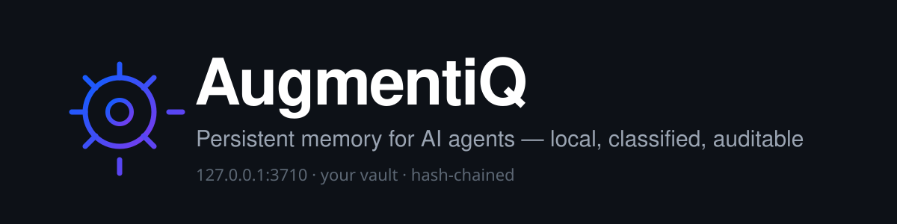
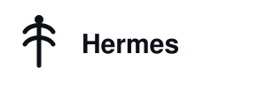
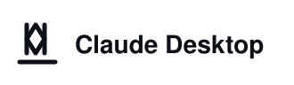
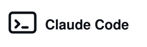
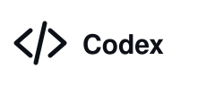

<p align="center">
  <picture>
    
  </picture>
</p>

<h1 align="center">AugmentiQ</h1>

<p align="center">
  <b>Persistent memory for AI agents, living in your Obsidian vault.</b><br>
  Local. Classified. Auditable. Yours.
</p>

<p align="center">
  <a href="./LICENSE"></a>
  
  
  <a href="https://agentskills.io"></a>
</p>

<p align="center">
  <b>Use with</b><br>
  &nbsp;&nbsp;
  &nbsp;&nbsp;
  &nbsp;&nbsp;
  &nbsp;&nbsp;
  &nbsp;&nbsp;
  
</p>

---

Your agent starts every session from zero. AugmentiQ gives it a memory that survives the session, stores itself as plain Markdown you can read, and keeps a tamper-evident audit trail of everything it learned.

It runs entirely on your machine. The server binds `127.0.0.1`, your vault is the database, and no data leaves the host.

**Free for personal use.** Commercial and enterprise deployments: [see below](#license).

## Install

Three steps, no Docker, no daemon.

| Step | What | How |
|---|---|---|
| **1** | The memory | Obsidian → Community plugins → **AugmentiQ** → Enable → copy the token from the ribbon |
| **2** | The tools | `openclaw plugins install clawhub:upsurge/augmentiq`, then paste the token |
| **3** | The judgement | `openclaw skills install augmentiq` |

Per-host guides for Hermes, Claude Desktop, Claude Code, Codex and Cursor: [`docs/public/install/`](./docs/public/install/).

## The problem it actually solves

Ask an agent to research a market and you get a paragraph. The reason is not the model — it is that the agent has nowhere to put what it finds. Nothing accumulates, so every investigation starts cold, and cold investigations stay shallow because depth costs tokens.

Give the same agent a memory and the work changes shape:

| Without AugmentiQ | With AugmentiQ |
|---|---|
| One prompt, one answer | A swarm of agents, each appending findings |
| Findings die with the session | Findings land in the vault as structured Markdown |
| You re-explain context every time | The agent recalls it and resumes where you stopped |
| Output is a wall of chat text | Output is a reviewable document tree you can diff |
| You cannot tell what it knew, or when | Every write is timestamped and hash-chained |

That is the product: not chat history, but a working memory that compounds.

## What you get

- **A real memory store.** Every memory is a Context Record — stable id, event timestamp separate from stored timestamp, scope, source, tags, classification. It lives in `.augmentiq/memories.jsonl` inside your vault.
- **A tamper-evident audit trail.** Every state change appends a SHA-256 hash-chained entry to `.augmentiq/audit.log`. Verification is served, not promised.
- **Memory that becomes understanding.** Observations accumulate; repetition becomes conclusions; stable conclusions become the profile. Weekly consolidation turns drift into structure.
- **Ten tools, two surfaces.** Five contract tools for governance flows, five consumer tools for the recall → reason → respond → record loop.
- **Your vault as the interface.** Readable, diffable, backupable. No proprietary store and no export step.
- **A skill that carries judgement.** When to remember, when to ask, when to refuse — 26 subcommands, 10 flows, five immutable principles.
- **Read-only mode that holds.** Enforced at the server, so a cautious install genuinely cannot write.

## How a turn runs

```
recall  →  reason  →  respond  →  record  →  consolidate
```

Only the last two touch storage, and consolidation is non-destructive: it surfaces duplicates, contradictions and stale records for you to decide on.

Full mechanism — how a vault becomes structured long-term memory, how the layers build, what the audit chain is actually for: **[How memory compounds](./docs/public/HOW-MEMORY-COMPOUNDS.md)**.

## Configuration

| Setting | What it does | Default |
|---|---|---|
| `port` | Port for the embedded MCP server | `3710` |
| `token` | Bearer token agents authenticate with | generated on first enable |
| `readOnly` | Rejects every write with `-32002` | `false` |
| `serverEnabled` | Run the server while Obsidian is open | `true` |

Memory data lives in `.augmentiq/` at the vault root. Plugin settings live in the plugin's `data.json`, excluded from git by the default vault ignore rules.

## Requirements

- **Obsidian desktop** — the plugin is `isDesktopOnly`; mobile is not supported in v0.1.
- **Obsidian must be running** — the server lives inside the app.
- **No Docker** — the embedded server replaces the container for this backend.

## Reference

| Document | What's inside |
|---|---|
| [How memory compounds](./docs/public/HOW-MEMORY-COMPOUNDS.md) | The four layers, how observations become conclusions, why the audit chain matters |
| [Architecture](./docs/public/ARCHITECTURE.md) | How skill, bridge and vault server fit together |
| [Security](./docs/public/SECURITY.md) | Threat model, token handling, what local-only buys you |
| [Install guides](./docs/public/install/) | Per host, tested |
| [SKILL.md](./SKILL.md) | The agent-facing playbook |
| [record-schema.md](./references/record-schema.md) | Canonical schemas, tool signatures, error codes |
| [Technical manual deck](./docs/public/deck/) | HTML and PPTX |

## Troubleshooting

**Tools return "not configured".** No token in the host config. It must be a literal string — SecretRefs do not resolve for plugin config objects.

**Tools return 401.** The token was regenerated in Obsidian. Copy the new one.

**"Server unreachable".** Obsidian is closed or the plugin is disabled. Check the status bar reads `AugmentiQ:3710`.

**Port already in use.** Change the port in plugin settings and update the host's `baseUrl`.

## Status

v0.1. The vault plugin runs against a real vault: memory round-trip, redaction, audit-chain verification and the full tool surface are tested end to end. The OpenClaw bridge and the skill are installed and loaded. Not yet proven: sustained multi-day use, clean-machine installation, public distribution.

## License

The AugmentiQ plugin and skill are **MIT** — free for personal and commercial use. See [`LICENSE`](./LICENSE).

**Commercial and enterprise deployments** — multi-user org memory, compliance packs (GDPR, SOC 2, HIPAA, ISO 27001), the AugmentIQ+ Docker backend, legacy-data ingest, or a supported rollout — are handled directly. Write to **customdev@upsurge.ae**.

There is no paid tier hiding behind the free one. The plugin stays free, MIT, and fully functional. We get paid when an organisation needs governance guarantees, scale, or someone accountable for the deployment.
